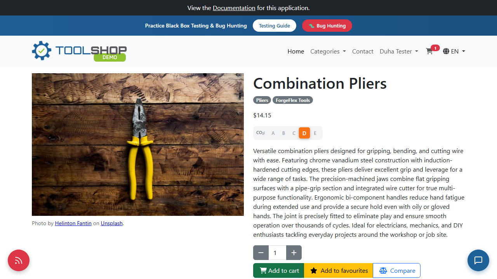
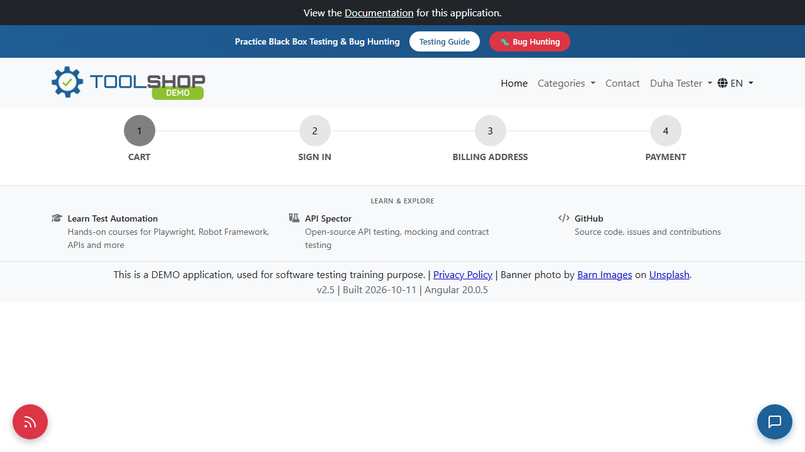

# BUG-UI-001: A logged-in user's cart is lost when the shop is opened in a new tab

| Priority | Severity | Status | Found by |
| --- | --- | --- | --- |
| **Medium** | Medium | Open | TC-CART-08 |

## Description

The cart is saved in the browser tab's **session storage** (`cart_id`), not in the user's account. So when a **logged-in** user opens the shop in a second tab, they are still logged in, but their cart is **empty**.

Customers often open products in new tabs to compare them. Every time they do, the products they added disappear from the cart, which can lead to lost sales and confusion ("I added this already, where did it go?").

**Tab 1:** the user is logged in as "Duha Tester", and the cart icon shows **1** item.



**Tab 2, same user, same browser:** still logged in as "Duha Tester", but the cart icon is gone and the cart page is empty.



**Videos recorded by the automated test:**

- Tab 1, adding the product: 
- Tab 2, opening the cart: 

## Expected result

A logged-in user sees the same cart in every tab and every browser, because the cart belongs to their account.

## Actual result

- The new tab shows the user as logged in, but with **no cart icon** and an **empty cart page**.
- The cart only exists in the tab where the products were added.

## Environment

| | |
| --- | --- |
| **Site** | Practice Software Testing – Toolshop: `https://practicesoftwaretesting.com` |
| **App version** | Toolshop v5.0 · front end v2.5, built 2026-10-11, Angular 20.0.5 (shown in the page footer) |
| **Browser** | Chromium (Playwright "Desktop Chrome", 1280×720) · also reproduced manually in Chrome |
| **Test tool** | Playwright with TypeScript |
| **OS** | Windows 11 |
| **Account** | A new user created by the test setup for this run |
| **Date found** | October 25, 2026 |

## Steps to reproduce

1. Log in.
2. Open any product, for example **Combination Pliers**, and click **Add to cart**.
3. See the cart icon in the header showing **1**.
4. Open `https://practicesoftwaretesting.com/checkout` in a **new tab** of the same browser.
5. See that you are still logged in, but the cart is empty and the cart icon is gone.

**Root cause:** the cart ID is stored in `sessionStorage`, which every browser tab keeps separately. Open DevTools → **Application → Session Storage** to see `cart_id` in the first tab only.

## Additional observation

The empty cart looks different depending on how it became empty:

- After deleting the last product, the page shows **"The cart is empty"**.
- In a new tab, the page shows only the checkout steps, with **no message at all**.

The second case leaves the user without any explanation.

## Verification: test that must pass once fixed

```bash
npx playwright test -g "TC-CART-08"
```

The test is marked as a known bug with `test.fail(...)`. After the fix it starts passing, and Playwright reports it as a failure. That's the signal to remove the `test.fail(...)` line from `tests/cart.spec.ts`.