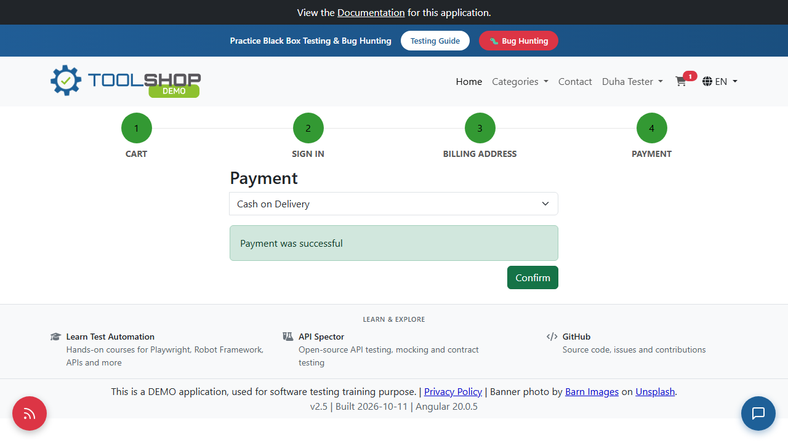

# BUG-UI-002: Order fails silently after "Payment was successful", with no error shown

| Priority | Severity | Status | Found by |
| --- | --- | --- | --- |
| **High** | High | Open | TC-CHECKOUT-09 |

## Description

At the last checkout step, the customer clicks **Confirm** and sees **"Payment was successful"**. When they click **Confirm** again to place the order, **nothing happens**: no order confirmation, no error message, and the page stays the same.

Behind the scenes, the server rejects the order with `422 Unprocessable Entity` and a clear error message, but the page never shows it. So:

- the customer is told the **payment succeeded**, but **no order is created**,
- they don't know why, and they can't fix it,
- clicking Confirm again repeats the same silent failure.

This is what happens with any real address (see [BUG-UI-003](BUG-UI-003-real-addresses-rejected.md)).



Video recorded by the automated test: 

## Expected result

- If the order can't be placed, the page shows the server's error, for example *"The city does not belong to the selected country"*, and lets the customer correct the address.
- "Payment was successful" is shown only when the order is actually placed.

## Actual result

- "Payment was successful" is shown, then **Confirm does nothing**.
- The server's answer, seen in DevTools → Network:

```http
POST https://api.practicesoftwaretesting.com/invoices  →  422 Unprocessable Entity

{"billing_country":["The billing_country does not match the entered address. The city does not belong to the selected country."]}
```

- No order is created, and the product stays in the cart.

## Environment

| | |
| --- | --- |
| **Site** | Practice Software Testing – Toolshop: `https://practicesoftwaretesting.com` |
| **API** | `https://api.practicesoftwaretesting.com` |
| **App version** | Toolshop v5.0 · front end v2.5, built 2026-10-11, Angular 20.0.5 (shown in the page footer) |
| **Browser** | Chromium (Playwright "Desktop Chrome", 1280×720) · also reproduced manually in Chrome |
| **Test tool** | Playwright with TypeScript |
| **OS** | Windows 11 |
| **Date found** | October 25, 2026 |

## Steps to reproduce

1. Log in, add **Combination Pliers** to the cart, and open the cart.
2. Click **Proceed to checkout** twice (cart, then sign in).
3. Enter a real billing address: Country **Palestine**, Postal code `00970`, House number `12`, Street `Al-Irsal Street`, City `Ramallah`, State `Ramallah and Al-Bireh`. Continue.
4. Choose **Cash on Delivery** and click **Confirm**: "Payment was successful" appears.
5. Click **Confirm** again.
6. Nothing happens. Open DevTools → **Network** to see the `422` response.

## Verification: test that must pass once fixed

```bash
npx playwright test -g "TC-CHECKOUT-09"
```

The test expects an error message to appear when the order is rejected. It's marked as a known bug with `test.fail(...)`. After the fix, remove that line from `tests/checkout.spec.ts`.

**Related:** [BUG-UI-003](BUG-UI-003-real-addresses-rejected.md)
