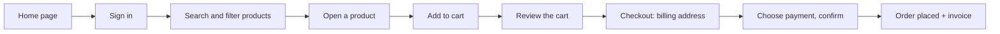

# UI Test Plan – Toolshop E-commerce Website

| | |
| --- | --- |
| **Website** | Practice Software Testing – Toolshop: https://practicesoftwaretesting.com |
| **Features tested** | Login, product search, shopping cart, checkout |
| **Test tool** | Playwright with TypeScript |
| **Browser** | Chromium (Desktop Chrome, 1280×720) |
| **Bugs** | See the [README](../README.md#bugs-found) |

## 1. Goal

Make sure a customer can complete the main shopping journey on the website: log in, find products, add them to the cart, and place an order. Also check that the site handles wrong input correctly along the way.

## 2. Scope

**In scope**

- **Login:** correct and wrong details, form messages, signing out.
- **Search:** by keyword, category, brand, and price, alone and **combined**.
- **Cart:** adding, changing, and removing products, and price totals.
- **Checkout:** placing an order, required steps, payment methods, and the invoice.

**Out of scope**

- Real payments. The demo site doesn't charge money.
- Admin pages, emails, and browsers other than Chromium. These would be the next steps.

## 3. How to read this document

- Each test case has an **ID**, for example `TC-CART-02`. The automated test has the same ID in its name, so the HTML report maps directly to this document.
- **Priority:** High = blocks shopping or loses data. Medium = affects the experience. Low = minor.
- **Automation:** `Automated` = covered by a Playwright test. `Automated (DDT)` = one test runs several rows of data (data-driven testing).
- **Expected result** is how the site **should** behave. Any difference is reported as a bug.

## 4. Test flows

The main customer journey:

| Flow | What the customer does | Test cases |
| --- | --- | --- |
| **Login** | Opens **Sign in**, enters email and password | TC-LOGIN-01 to 08 |
| **Search** | Types a keyword, ticks categories and brands, moves the price slider | TC-SEARCH-01 to 10 |
| **Cart** | Opens a product, picks a quantity, clicks **Add to cart**, reviews or changes the cart | TC-CART-01 to 08 |
| **Checkout** | From the cart: continues past sign-in, enters a billing address, chooses a payment method, confirms twice, gets an invoice | TC-CHECKOUT-01 to 09 |

## 5. Test approach

- **A new user for every run.** Before the tests start, a new account is created through the site's official API, then used to log in. Tests never depend on a shared account that someone else could change or lock, or on the demo's database resets.
- **Logged in once.** The login is saved after the first time (Playwright "storage state"), so search, cart, and checkout tests start already logged in.
- **Page Object Model.** Each page has one file with its fields and buttons. If the site changes, it's fixed in one place.
- **Stable locators.** The site marks its elements with `data-test` attributes, which the tests use.
- **Data-driven tests.** Test data lives in the `data/` folder. One test can run many rows.
- **No fixed waits.** Assertions keep retrying until the page updates, which keeps tests fast and stable.
- **Known bugs stay in the suite.** Tests for open bugs are marked with `test.fail(...)` and the bug ID. The run stays green, and when a bug is fixed, the test reminds us to remove the mark.

## 6. Test cases

### 6.1 Login

| ID | Test case | Steps | Test data | Expected result | Priority | Automation |
| --- | --- | --- | --- | --- | --- | --- |
| TC-LOGIN-01 | Log in with valid details | 1. Click **Sign in** 2. Enter email and password 3. Click **Login** | The test user | "My account" page opens, user menu is shown | High | Automated |
| TC-LOGIN-02 | Wrong password | Same as TC-LOGIN-01 | Correct email, wrong password | "Invalid email or password" | High | Automated (DDT) |
| TC-LOGIN-03 | Email that isn't registered | Same as TC-LOGIN-01 | `not-registered-qa@example.com` | "Invalid email or password" | High | Automated (DDT) |
| TC-LOGIN-04 | Empty email | Leave email empty, click **Login** | Empty email | "Email is required" under the field | Medium | Automated (DDT) |
| TC-LOGIN-05 | Email without @ | Same as TC-LOGIN-01 | `not-an-email` | "Email format is invalid" | Medium | Automated (DDT) |
| TC-LOGIN-06 | Empty password | Leave password empty, click **Login** | Empty password | "Password is required" | Medium | Automated (DDT) |
| TC-LOGIN-07 | Password is hidden | Type a password | Any password | The field shows dots, not the password | High | Automated |
| TC-LOGIN-08 | Sign out | Log in, open the user menu, click **Sign out**, then open "My account" | The test user | **Sign in** link is back, "My account" redirects to the login page | High | Automated |

### 6.2 Search

The search criteria are **keyword**, **category**, **brand**, and **price**. They can be used alone or together.

The tests don't depend on which products the shop has. For each search, they check, in this order:

1. **Every product on the screen follows every rule:** its name contains the keyword, its brand and category (read from its product page) match the filters, and its price is under the maximum. At least one product must be shown.
2. **The screen shows exactly what the server sent:** the names on the screen are compared with the server's answer, so nothing is missing, extra, or duplicated.

| ID | Test case | Steps | Test data | Expected result | Priority | Automation |
| --- | --- | --- | --- | --- | --- | --- |
| TC-SEARCH-01 | Keyword only | Type a keyword, click **Search** | `pliers` | Every product name contains "pliers", and the screen matches the server's answer | High | Automated (DDT) |
| TC-SEARCH-02 | Category only | Tick a category | **Hammer** | Every product's category is Hammer, and the screen matches the server's answer | High | Automated (DDT) |
| TC-SEARCH-03 | Brand only | Tick a brand | **ForgeFlex Tools** | Every product's brand is ForgeFlex Tools, and the screen matches the server's answer | High | Automated (DDT) |
| TC-SEARCH-04 | Keyword + brand | Search, then tick a brand | `pliers` + **MightyCraft Hardware** | Every product matches both, and the screen matches the server's answer | High | Automated (DDT) |
| TC-SEARCH-05 | **Three criteria together** | Search, tick a category, tick a brand | `pliers` + **Pliers** + **ForgeFlex Tools** | Every product matches all three, and the screen matches the server's answer | High | Automated (DDT) |
| TC-SEARCH-06 | Keyword + maximum price | Search, move the price slider's maximum down to $13 | `pliers`, max $13 | At least one product, every price is at or below the maximum, every name contains "pliers" | High | Automated |
| TC-SEARCH-07 | Not case-sensitive | Search the same word in lowercase, then in uppercase | `pliers` / `PLIERS` | Both searches show the same products | Medium | Automated |
| TC-SEARCH-08 | Unknown keyword | Search a word that matches nothing | `xyz123notexist` | "There are no products found." and "0 products found" | Medium | Automated |
| TC-SEARCH-09 | Reset the search | Search, then click **Reset** | `pliers` | Search box is empty, and the same products as before the search are shown | Medium | Automated |
| TC-SEARCH-10 | Script in the search box | Search a script tag | `` | No pop-up runs, no results | High | Automated |

### 6.3 Cart

| ID | Test case | Steps | Test data | Expected result | Priority | Automation |
| --- | --- | --- | --- | --- | --- | --- |
| TC-CART-01 | Add a product | Open a product, click **Add to cart**, open the cart | Combination Pliers | "Product added to shopping cart.", cart icon shows 1, product is in the cart | High | Automated |
| TC-CART-02 | Add with a quantity | Set quantity, add to cart | Quantity 3 | Cart icon and cart show 3 | High | Automated |
| TC-CART-03 | Two different products | Add one product, then another | Combination Pliers + Pliers | Cart lists both | High | Automated |
| TC-CART-04 | Totals are correct | Add 2 + 1 products, open the cart | $14.15 × 2 + $12.01 | Each line = price × quantity, total = sum of lines | High | Automated |
| TC-CART-05 | Change quantity in the cart | In the cart, change quantity and leave the field | 1 → 3 | "Product quantity updated.", line total and cart icon update | High | Automated |
| TC-CART-06 | Remove a product | Click the delete button | Combination Pliers | "Product deleted.", "The cart is empty", cart icon disappears | High | Automated |
| TC-CART-07 | Cart kept after reload | Add a product, reload the page | Combination Pliers | Product is still in the cart | Medium | Automated |
| TC-CART-08 | Cart kept in a new tab | Add a product, open the cart in a new tab (still logged in) | Combination Pliers | Same cart in the new tab | Medium | Automated · known bug **BUG-UI-001** |

### 6.4 Checkout

Every checkout test starts with one product (Combination Pliers) in the cart.

| ID | Test case | Steps | Test data | Expected result | Priority | Automation |
| --- | --- | --- | --- | --- | --- | --- |
| TC-CHECKOUT-01 | Order with Cash on Delivery | Cart → sign in → address → payment → **Confirm** twice | Address filled from postal code `10001` | "Payment was successful", then "Thanks for your order! Your invoice number is INV-…", cart is empty | High | Automated (DDT) |
| TC-CHECKOUT-02 | Order with Credit Card | Same, with card details | `4111-1111-1111-1111`, `12/2030`, `123` | Same as TC-CHECKOUT-01 | High | Automated (DDT) |
| TC-CHECKOUT-03 | Logged-in user skips sign-in | Go to step 2 | The test user | "You are already logged in" and the next button works | Medium | Automated |
| TC-CHECKOUT-04 | Address is required | Go to step 3, enter nothing | – | Continue button is disabled | High | Automated |
| TC-CHECKOUT-05 | Payment method is required | Go to step 4, choose nothing | – | Confirm button is disabled | High | Automated |
| TC-CHECKOUT-06 | Invalid card number | Choose Credit Card, enter a short number | `1234` | "Invalid card number format.", Confirm is disabled | High | Automated |
| TC-CHECKOUT-07 | Invoice is correct | Place an order, open **My invoices**, open the invoice | – | Invoice number, total, address, and payment method match the order | High | Automated |
| TC-CHECKOUT-08 | Order with a real address | Enter a real address and place the order | Ramallah, Palestine | Order is placed | High | Automated · known bug **BUG-UI-003** |
| TC-CHECKOUT-09 | Error shown when an order is rejected | Place an order the server rejects | Ramallah, Palestine | A clear error message is shown | High | Automated · known bug **BUG-UI-002** |

## 7. Entry and exit criteria

**Start testing when:** the website is reachable, and the user registration API works (the test setup checks both).

**Testing is done when:** every High priority test case passes or has a bug ticket, and every bug found is reported.

## 8. Risks

| Risk | Impact | How it's handled |
| --- | --- | --- |
| The demo site is public and shared with others | Data can change | Each run uses its own new user; cart tests use a cart that only exists in their own browser tab |
| The demo database is reset regularly | Accounts disappear | A new user is created through the API at the start of every run |
| Product IDs change after a reset | Links to products break | Products are found by name, not by link |
| The demo site goes down | All tests fail | Results of the last successful run are kept in the HTML report and the CI artifacts |