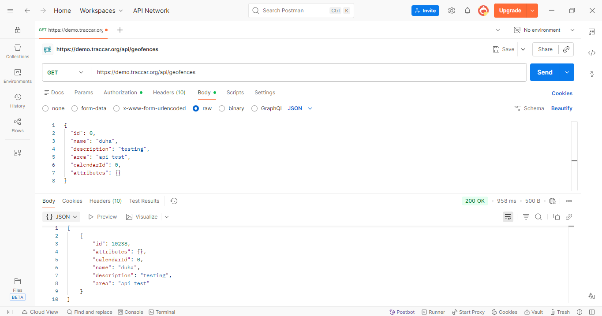
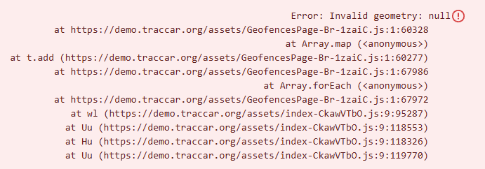

# BUG-API-001: API saves geofences with an invalid area, which crashes the Geofences page

| Priority | Severity | Status | Found by |
| --- | --- | --- | --- |
| **High** | High | Open | TC-CREATE-12, 13, 14, 15 · TC-UPDATE-09, 10 · manual test in Postman |

## Description

The API doesn't check that the `area` field is a valid shape. Any text is saved: a shape that doesn't exist, a broken format, letters instead of numbers, or an empty value. As shown below when sending the request via Postman the `status code` is `200 OK`


The web app then tries to draw that saved area on the map and fails. **The whole Geofences page crashes**, so the user can't see or edit any of their geofences, not just the broken one.



*The Geofences page after one geofence with `"area": "api test"` was saved through the API.*

## Expected result

- The API returns **`400 Bad Request`** with a clear message, such as *"area must be a valid CIRCLE, POLYGON, or LINESTRING"*.
- Nothing is saved.
- The Geofences page keeps working.

## Actual result

- The API returns **`200 OK`** and saves the geofence for every invalid value below.
- Opening **Settings → Geofences** shows `Error: Invalid geometry: null` and the page doesn't load.

| Test | `area` sent | Expected | Actual |
| --- | --- | --- | --- |
| TC-CREATE-12 | `CIRCLE (abc def, 500)` | 400 | 200 |
| TC-CREATE-13 | `SQUARE (31.9 35.2, 500)` | 400 | 200 |
| TC-CREATE-14 | `CIRCLE (31.9` | 400 | 200 |
| TC-CREATE-15 | `""` (empty) | 400 | 200 |
| TC-UPDATE-09 | Update to `CIRCLE (31.9` | 400 | 200 |
| TC-UPDATE-10 | Update to `""` (empty) | 400 | 200 |
| Manual (Postman) | `api test` | 400 | 200 + page crash |

## Environment

| | |
| --- | --- |
| **Server** | Traccar demo server – `https://demo.traccar.org` |
| **Traccar version** | **6.16.0** (read from `GET /api/server`, also shown in the test report under **Environment**) |
| **API** | Traccar REST API, JSON over HTTPS, Basic auth / session login |
| **Client** | Python 3.12.6, pytest 8.3.3, requests · Postman for manual checks |
| **OS** | Windows 11 |
| **Date found** | October 23, 2026 |
| **Browser (UI crash)** | Chrome (latest) |

## Steps to reproduce

1. Log in to `https://demo.traccar.org` (web app) and to the API with the same account.
2. Send this request:
   ```http
   POST /api/geofences
   Content-Type: application/json

   { "name": "Broken area", "area": "api test" }
   ```
3. See the response: `200 OK` with the saved geofence.
4. In the web app, open **Settings → Geofences**.
5. See the page crash with `Error: Invalid geometry: null`.

**Workaround:** delete the broken geofence with `DELETE /api/geofences/{id}`. The page works again.

## Verification: tests that must pass once fixed

```bash
py -m pytest -k "TC-CREATE-12 or TC-CREATE-13 or TC-CREATE-14 or TC-CREATE-15 or TC-UPDATE-09 or TC-UPDATE-10"
```

These tests are marked as known bugs (`xfail`, strict). After the fix they start passing, and pytest reports them as **XPASS (failed)**. That's the signal to remove the `"bug"` key from those rows in `data/geofence_data.py`, so they run as normal tests again.