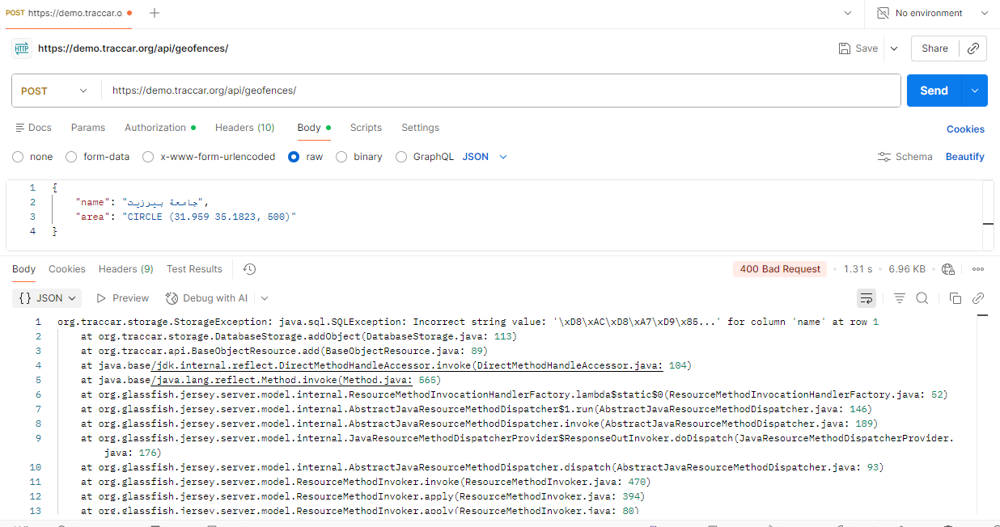

# BUG-API-002: Geofence names in Arabic (non-Latin letters) can't be saved

| Priority | Severity | Status | Found by |
| --- | --- | --- | --- |
| **High** | High | Open | TC-CREATE-07, TC-UPDATE-06 |

## Description

Creating a geofence with an Arabic name fails with a database error. The database column for `name` doesn't accept these characters, which points to a character set that doesn't support all languages (MySQL needs `utf8mb4`).

This affects every user who writes in Arabic, and very likely other languages with non-Latin letters, such as Hebrew, Chinese, or emoji in names.



## Expected result

- **`200 OK`**, and the geofence is saved with the name exactly as sent: `جامعة بيرزيت`.
- Reading it back returns the same Arabic name.

## Actual result

- **`400 Bad Request`**, and the geofence isn't saved.
- The response body is a database error:
  ```
  org.traccar.storage.StorageException: java.sql.SQLException:
  Incorrect string value: '\xD8\xAC\xD8\xA7\xD9\x85...' for column 'name' at row 1
  ```
  (`\xD8\xAC\xD8\xA7\xD9\x85` is the start of "جامعة" in UTF-8.)

## Environment

| | |
| --- | --- |
| **Server** | Traccar demo server – `https://demo.traccar.org` |
| **Traccar version** | **6.16.0** (read from `GET /api/server`, also shown in the test report under **Environment**) |
| **API** | Traccar REST API, JSON over HTTPS, Basic auth / session login |
| **Client** | Python 3.12.6, pytest 8.3.3, requests · Postman for manual checks |
| **OS** | Windows 11 |
| **Date found** | October 23, 2026 |
| **Database (from the error)** | MySQL, via the MySQL Connector/J driver |

## Steps to reproduce

1. Log in to the API.
2. Send this request:
   ```http
   POST /api/geofences
   Content-Type: application/json

   { "name": "جامعة بيرزيت", "area": "CIRCLE (31.959 35.1823, 500)" }
   ```
3. See `400 Bad Request` with the `Incorrect string value` error.

## Verification: tests that must pass once fixed

```bash
py -m pytest -k "TC-CREATE-07 or TC-UPDATE-06"
```

Both are marked as known bugs (`xfail`, strict). After the fix, remove the `"bug"` key from those rows in `data/geofence_data.py`.

**Related:** [BUG-API-003](BUG-API-003-stack-trace-exposed.md). The error response for this request also exposes the server's stack trace.