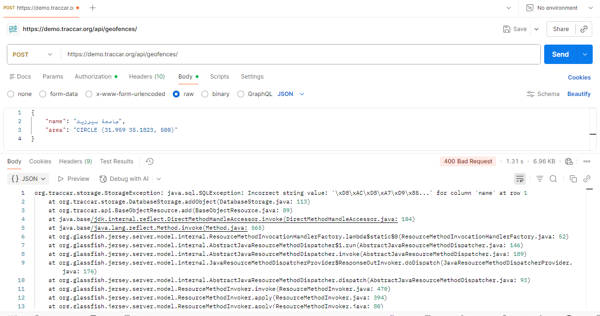
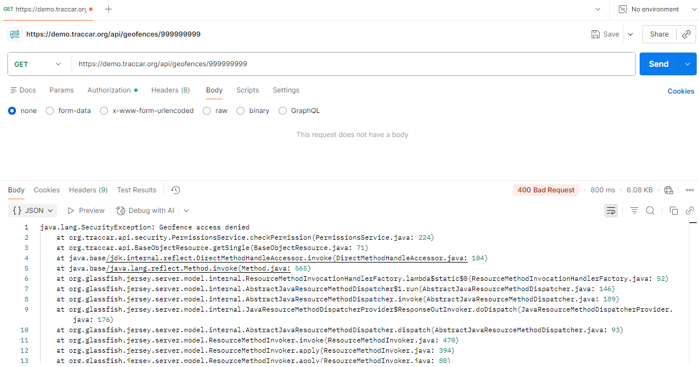

# BUG-API-003: Error responses expose the server's internal details (stack trace)

| Priority | Severity | Status | Found by |
| --- | --- | --- | --- |
| **High** | Medium | Open | TC-CREATE-24 · seen while investigating BUG-API-002 and BUG-API-006 |

**Type:** Security – information disclosure

## Description

When a request fails, the API sends the **full Java stack trace** back to the client instead of a short error message. This happens for **different kinds of errors**, not just one:

- a **database error**, such as saving an Arabic name (BUG-API-002),
- a **permission check**, such as asking for a geofence that doesn't exist (BUG-API-006).

The stack trace reveals:

- the database: **MySQL** (`com.mysql.cj.jdbc`),
- the web server and frameworks: **Jetty**, **Jersey**, **Guice**, **HikariCP**,
- internal class names, file names, and line numbers, for example `PermissionsService.java:224` and `DatabaseStorage.java:113`,
- how security checks work internally (`org.traccar.api.security.PermissionsService.checkPermission`).

Attackers use this kind of information to find which versions are running and look up known vulnerabilities.

**Database error (create with an Arabic name):**



**Permission error (read a geofence that doesn't exist):**



## Expected result

- A short, safe message for the client, for example:
  ```json
  { "error": "Geofence not found" }
  ```
- The technical details are written **only to the server logs**.

## Actual result

The response body is the raw stack trace, about 60 lines, for every failing request below:

| Request | Status | First line of the response body |
| --- | --- | --- |
| `GET /api/geofences/999999999` | 400 | `java.lang.SecurityException: Geofence access denied` |
| `POST /api/geofences` with an Arabic name | 400 | `org.traccar.storage.StorageException: java.sql.SQLException: Incorrect string value: ...` |

Example, from the first request:

```
java.lang.SecurityException: Geofence access denied
	at org.traccar.api.security.PermissionsService.checkPermission(PermissionsService.java:224)
	at org.traccar.api.BaseObjectResource.getSingle(BaseObjectResource.java:71)
	at org.glassfish.jersey.server.model.internal.ResourceMethodInvocationHandlerFactory...
	...
```

## Environment

| | |
| --- | --- |
| **Server** | Traccar demo server – `https://demo.traccar.org` |
| **Traccar version** | **6.16.0** (read from `GET /api/server`, also shown in the test report under **Environment**) |
| **API** | Traccar REST API, JSON over HTTPS, Basic auth / session login |
| **Client** | Python 3.12.6, pytest 8.3.3, requests · Postman for manual checks |
| **OS** | Windows 11 |
| **Date found** | October 23, 2026 |

## Steps to reproduce

1. Log in to the API.
2. Ask for a geofence that doesn't exist:
   ```http
   GET /api/geofences/999999999
   ```
3. Read the response body: it contains the full stack trace.

The same happens with `POST /api/geofences` and the body `{ "name": "جامعة بيرزيت", "area": "CIRCLE (31.959 35.1823, 500)" }`.

## Verification: test that must pass once fixed

```bash
py -m pytest -k "error_response_hides_server_details"
```

The test reads a geofence that doesn't exist and checks that the response contains no `Exception` and no `org.traccar` text. It doesn't depend on BUG-API-002, so it stays valid even if the Arabic name issue is fixed first. It's marked as a known bug (`xfail`, strict). After the fix, remove the `@pytest.mark.xfail` line above the test.

**Related:** [BUG-API-002](BUG-API-002-arabic-names-not-saved.md), [BUG-API-006](BUG-API-006-missing-geofence-returns-400.md).