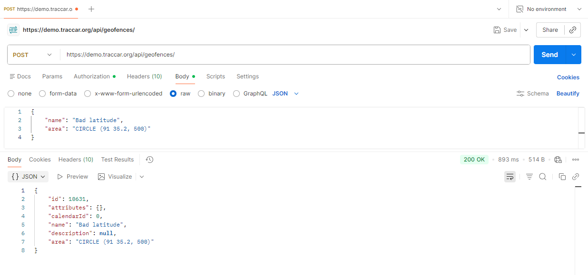

# BUG-API-004: API accepts coordinates that don't exist on Earth

| Priority | Severity | Status | Found by |
| --- | --- | --- | --- |
| **Medium** | Medium | Open | TC-CREATE-09, TC-CREATE-10, TC-UPDATE-07 |

## Description

Latitude must be between **-90 and 90**, and longitude between **-180 and 180**. The API saves geofences with values outside these limits, which are places that don't exist.

The data looks valid but is wrong. Depending on how a client draws it, it can show in the wrong place, be skipped, or break the map, similar to BUG-API-001.



## Expected result

**`400 Bad Request`** with a message such as *"latitude must be between -90 and 90"*. Nothing is saved.

## Actual result

**`200 OK`**, and the geofence is saved.

| Test | `area` sent | Problem | Expected | Actual |
| --- | --- | --- | --- | --- |
| TC-CREATE-09 | `CIRCLE (91 35.2, 500)` | latitude 91 > 90 | 400 | 200 |
| TC-CREATE-10 | `CIRCLE (31.9 181, 500)` | longitude 181 > 180 | 400 | 200 |
| TC-UPDATE-07 | Update to `CIRCLE (91 35.2, 300)` | latitude 91 > 90 | 400 | 200 |

## Environment

| | |
| --- | --- |
| **Server** | Traccar demo server – `https://demo.traccar.org` |
| **Traccar version** | **6.16.0** (read from `GET /api/server`, also shown in the test report under **Environment**) |
| **API** | Traccar REST API, JSON over HTTPS, Basic auth / session login |
| **Client** | Python 3.12.6, pytest 8.3.3, requests · Postman for manual checks |
| **OS** | Windows 11 |
| **Date found** | October 23, 2026 |

## Steps to reproduce

1. Log in to the API.
2. Send this request:
   ```http
   POST /api/geofences
   Content-Type: application/json

   { "name": "Bad latitude", "area": "CIRCLE (91 35.2, 500)" }
   ```
3. See `200 OK`, and the geofence appears in `GET /api/geofences`.

## Verification: tests that must pass once fixed

```bash
py -m pytest -k "TC-CREATE-09 or TC-CREATE-10 or TC-UPDATE-07"
```

Both are marked as known bugs (`xfail`, strict). After the fix, remove the `"bug"` key from those rows in `data/geofence_data.py`.