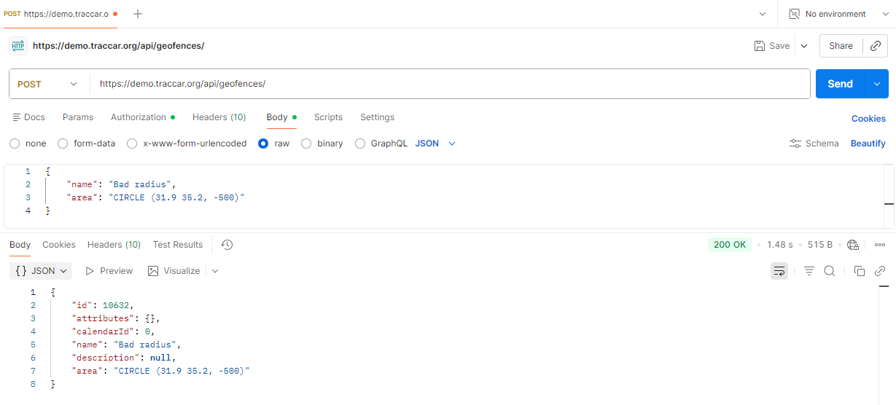

# BUG-API-005: API accepts a circle with a negative radius

| Priority | Severity | Status | Found by |
| --- | --- | --- | --- |
| **Medium** | Medium | Open | TC-CREATE-11, TC-UPDATE-08 |

## Description

A circle's radius is a distance in meters, so it must be greater than zero. The API saves a circle with a **negative radius**, which isn't a real area.

Features that depend on geofences, such as "alert me when a vehicle enters this area", can't work correctly with an area that has no real size.



## Expected result

**`400 Bad Request`** with a message such as *"radius must be greater than 0"*. Nothing is saved.

## Actual result

**`200 OK`**, and the geofence is saved.

| Test | Action | Expected | Actual |
| --- | --- | --- | --- |
| TC-CREATE-11 | Create with `CIRCLE (31.9 35.2, -500)` | 400 | 200 |
| TC-UPDATE-08 | Update to `CIRCLE (31.9 35.2, -300)` | 400 | 200 |

## Environment

| | |
| --- | --- |
| **Server** | Traccar demo server – `https://demo.traccar.org` |
| **Traccar version** | **6.16.0** (read from `GET /api/server`, also shown in the test report under **Environment**) |
| **API** | Traccar REST API, JSON over HTTPS, Basic auth / session login |
| **Client** | Python 3.12.6, pytest 8.3.3, requests · Postman for manual checks |
| **OS** | Windows 11 |
| **Date found** | October 23, 2026 |

## Steps to reproduce

1. Log in to the API.
2. Send this request:
   ```http
   POST /api/geofences
   Content-Type: application/json

   { "name": "Bad radius", "area": "CIRCLE (31.9 35.2, -500)" }
   ```
3. See `200 OK`, and the geofence appears in `GET /api/geofences`.

## Verification: test that must pass once fixed

```bash
py -m pytest -k "TC-CREATE-11 or TC-UPDATE-08"
```

Marked as a known bug (`xfail`, strict). After the fix, remove the `"bug"` key from that row in `data/geofence_data.py`.