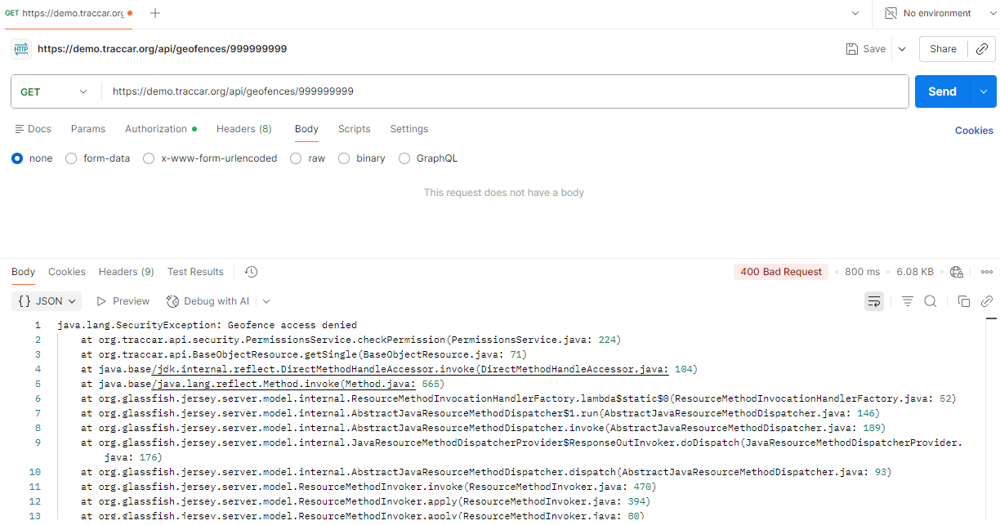
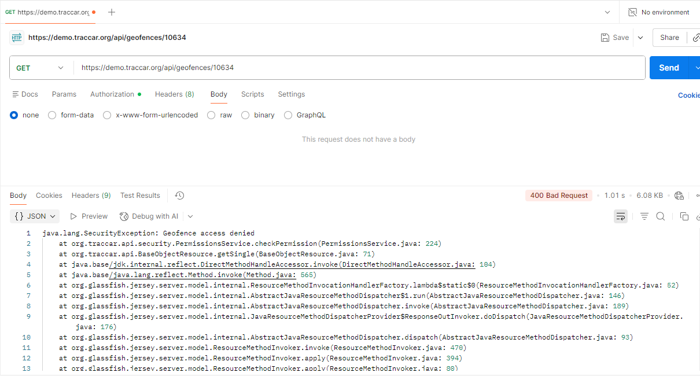

# BUG-API-006: Missing geofence returns 400 Bad Request instead of 404 Not Found

| Priority | Severity | Status | Found by |
| --- | --- | --- | --- |
| **Low** | Low | Open | TC-DELETE-02, 03, 04 · TC-UPDATE-12 |

## Description

When a geofence doesn't exist, because it was deleted or never existed, the API answers **`400 Bad Request`**. By the HTTP standard (RFC 9110), `400` means *"the request itself is wrong"*, and **`404 Not Found`** means *"what you asked for doesn't exist"*.

Because of this, a client can't tell **"you sent bad data"** apart from **"this geofence is gone"**. For example, an app can't safely show *"This geofence was already deleted"*, and retry logic may treat a missing item as a bug in its own request.

The API is also **inconsistent**: a text ID like `/api/geofences/abc` returns `404` (TC-DELETE-06), but a number that doesn't exist returns `400`.





## Expected result

**`404 Not Found`** for every request to a geofence that doesn't exist:

| Request | Expected |
| --- | --- |
| `GET /api/geofences/{deleted id}` | 404 |
| `DELETE /api/geofences/{deleted id}` (second delete) | 404 |
| `DELETE /api/geofences/999999999` | 404 |

## Actual result

| Test | Request | Expected | Actual |
| --- | --- | --- | --- |
| TC-DELETE-02 | `GET /api/geofences/{deleted id}` | 404 | **400** |
| TC-DELETE-03 | `DELETE /api/geofences/{deleted id}` | 404 | **400** |
| TC-DELETE-04 | `DELETE /api/geofences/999999999` | 404 | **400** |
| TC-UPDATE-12 | `PUT /api/geofences/999999999` | 404 | **400** |
| TC-DELETE-06 | `DELETE /api/geofences/abc` | 404 | 404 ✅ |

**Why it happens:** the response body shows the server treats a missing geofence as a **permission problem**:

```
java.lang.SecurityException: Geofence access denied
	at org.traccar.api.security.PermissionsService.checkPermission(PermissionsService.java:224)
```

Answering the same way for "not yours" and "doesn't exist" is a reasonable security choice, because it stops users from guessing which IDs exist. But the common practice is to return **`404`** for both, not `400`. The response also includes the full stack trace, reported separately in [BUG-API-003](BUG-API-003-stack-trace-exposed.md).

## Environment

| | |
| --- | --- |
| **Server** | Traccar demo server – `https://demo.traccar.org` |
| **Traccar version** | **6.16.0** (read from `GET /api/server`, also shown in the test report under **Environment**) |
| **API** | Traccar REST API, JSON over HTTPS, Basic auth / session login |
| **Client** | Python 3.12.6, pytest 8.3.3, requests · Postman for manual checks |
| **OS** | Windows 11 |
| **Date found** | October 24, 2026 |

## Steps to reproduce

1. Log in to the API.
2. Create a geofence:
   ```http
   POST /api/geofences
   Content-Type: application/json

   { "name": "Delete me", "area": "CIRCLE (31.9 35.2, 300)" }
   ```
   Note the `id` in the response.
3. Delete it: `DELETE /api/geofences/{id}` → `204 No Content` (correct).
4. Read it again: `GET /api/geofences/{id}` → **`400`** instead of `404`.
5. Delete it again: `DELETE /api/geofences/{id}` → **`400`** instead of `404`.

## Verification: tests that must pass once fixed

```bash
py -m pytest tests/test_delete_geofence.py -k "not_found or is_gone"
py -m pytest -k "update_geofence_that_does_not_exist"
```

TC-DELETE-02, 03, 04 and TC-UPDATE-12 are marked as known bugs (`xfail`, strict). After the fix, remove the `@pytest.mark.xfail` line above each of them.