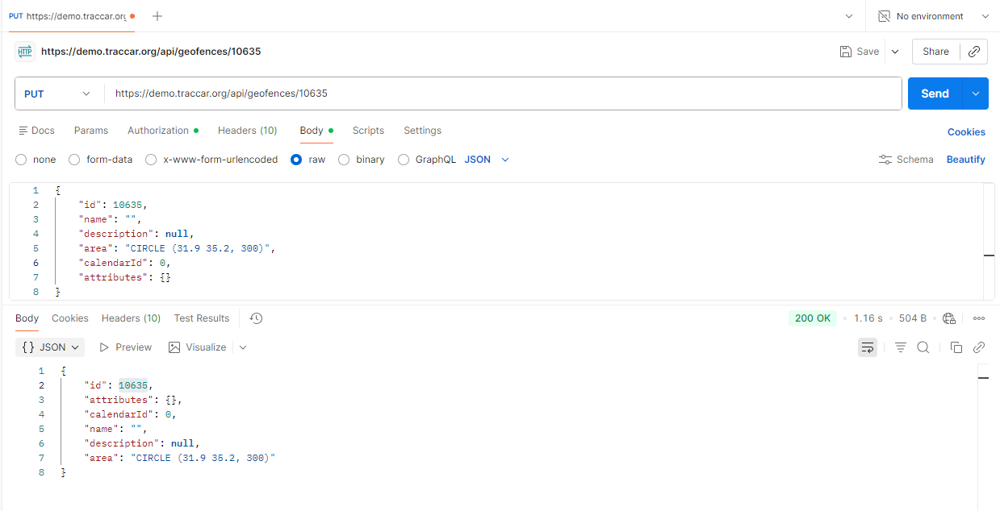

# BUG-API-007: A geofence's name can be changed to empty, although create requires a name

| Priority | Severity | Status | Found by |
| --- | --- | --- | --- |
| **Medium** | Medium | Open | TC-UPDATE-11 (compared with TC-CREATE-16) |

## Description

Creating a geofence **without a name is rejected** with `400` (TC-CREATE-16 passes). But **updating** an existing geofence to an **empty name** is accepted.

So the same rule is checked on create and skipped on update. The result is a geofence with no name, which users can't identify in the geofence list, in alerts, or on the map.


## Expected result

- `PUT /api/geofences/{id}` with `"name": ""` returns **`400 Bad Request`**, with a message such as *"name is required"*.
- The geofence keeps its original name.
- Create and update follow the same rules.

## Actual result

- **`200 OK`**, and the geofence is saved with an empty name.

| Test | Action | Expected | Actual |
| --- | --- | --- | --- |
| TC-CREATE-16 | Create without `name` | 400 | 400 ✅ |
| TC-UPDATE-11 | Update `name` to `""` | 400 | **200** |

## Environment

| | |
| --- | --- |
| **Server** | Traccar demo server – `https://demo.traccar.org` |
| **Traccar version** | **6.16.0** (read from `GET /api/server`, also shown in the test report under **Environment**) |
| **API** | Traccar REST API, JSON over HTTPS, Basic auth / session login |
| **Client** | Python 3.12.6, pytest 8.3.3, requests · Postman for manual checks |
| **OS** | Windows 11 |
| **Date found** | October 24, 2026 |

## Steps to reproduce

1. Log in to the API.
2. Create a geofence:
   ```http
   POST /api/geofences
   Content-Type: application/json

   { "name": "Original geofence", "area": "CIRCLE (31.9 35.2, 300)" }
   ```
   Note the full response, including `id`.
3. Send the same object back with an empty name:
   ```http
   PUT /api/geofences/{id}
   Content-Type: application/json

   { "id": {id}, "name": "", "description": null, "area": "CIRCLE (31.9 35.2, 300)", "calendarId": 0, "attributes": {} }
   ```
4. See `200 OK`. `GET /api/geofences/{id}` now returns `"name": ""`.

## Verification: test that must pass once fixed

```bash
py -m pytest -k "TC-UPDATE-11"
```

Marked as a known bug (`xfail`, strict). After the fix, remove the `"bug"` key from that row in `data/geofence_data.py`.