# Part 3 – Load Test: BlazeDemo Homepage

A load test that sends **1000 users to a website's homepage within 15 seconds**, and measures the response time **before, during, and after** the load.

| | |
| --- | --- |
| **Website** | BlazeDemo – https://blazedemo.com |
| **Protocol** | HTTPS |
| **Tool** | Apache JMeter 5.6.3, run from the command line (non-GUI mode) |
| **Test plan** | [`homepage-load-test.jmx`](homepage-load-test.jmx) |
| **Full HTML report** | [`results/report/index.html`](results/report/index.html) (open it in a browser after downloading the repository) |
| **Raw results** | [`results/results.csv`](results/results.csv) – one line per request |
| **Run date** | October 25, 2026, 18:54–18:55 (EET) |
| **Follow-up tests** | [`scalability-report.md`](scalability-report.md): a step test from 10 to 1000 users, and two repeat runs of the 1000-user test |

## Summary

| Question | Answer |
| --- | --- |
| Did the test reach the target load? | **Yes.** All 1000 requests started within 14.97 seconds |
| Did any request fail? | **No.** 1020 of 1020 requests returned `200 OK` (0% errors) |
| Did the load affect response time? | **Yes.** The typical request got **60% slower** (median 371 ms → 593 ms), and **4% of requests took 7–10 seconds**, waiting on the server side (p99 = 9066 ms) |
| Did the site recover? | **Mostly.** After the load, the median was 486 ms, close to the 371 ms before it |
| Where does the slowdown begin? | **Between 500 and 1000 users** in 15 seconds, from a [follow-up step test](scalability-report.md). The typical request didn't slow down at any step |

> **How the tests fit together:** baseline → main 1000-user test → step test (10 to 1000 users) → repeat 1000-user test after a rest. See [The order of the tests](scalability-report.md#the-order-of-the-tests).

## 1. Choosing the website

The task says *"choose a random web application"*. Sending 1000 users in 15 seconds to a site without permission could look like an attack (a denial of service), so I chose **BlazeDemo**, a demo site made by BlazeMeter **specifically for practicing load and performance testing**.

To be a polite visitor, every request also says it's a test: the `User-Agent` header is `Mozilla/5.0 (JMeter load test - QA practice)`, and the full test ran **once**.

## 2. How the test works

The test plan has **three phases that run one after another** (JMeter's *"Run Thread Groups consecutively"* option). Each phase has its own name, so the report shows them separately.

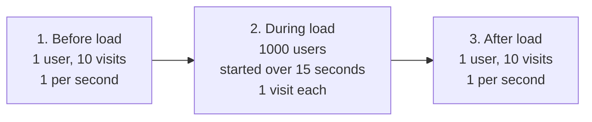

| Phase | Users | How they start | Visits per user | Wait between visits | Why |
| --- | --- | --- | --- | --- | --- |
| **1. Before load** | 1 | – | 10 | 1 second | Normal response time, with no load |
| **2. During load** | **1000** | Evenly over **15 seconds** (about 67 new users per second) | 1 | – | The load from the task |
| **3. After load** | 1 | – | 10 | 1 second | Does the site go back to normal? |

**Shared settings for every request:**

| Element | Setting |
| --- | --- |
| **HTTP Request Defaults** | `https://blazedemo.com`, connect timeout 10 s, response timeout 30 s |
| **Request** | `GET /` (the homepage HTML only, without images, CSS, or scripts, to focus on the server's response) |
| **HTTP Header Manager** | `User-Agent` that identifies the load test, `Accept: text/html` |
| **Response Assertion** | Every response must have status `200`, otherwise it counts as an error |

**Why non-GUI mode?** JMeter's window, and listeners like "View Results Tree", use a lot of memory and slow JMeter itself down under load, which makes the results look worse than they are. The test runs from the command line, and the HTML report is built from the results file afterwards. The plan has no listeners for the same reason.

**What "1000 users in 15 seconds" means in practice:** each user sends one request and is done as soon as it gets an answer, so the users overlap rather than all being active at the same moment. At the busiest point, **85 users were waiting for an answer at the same time**.

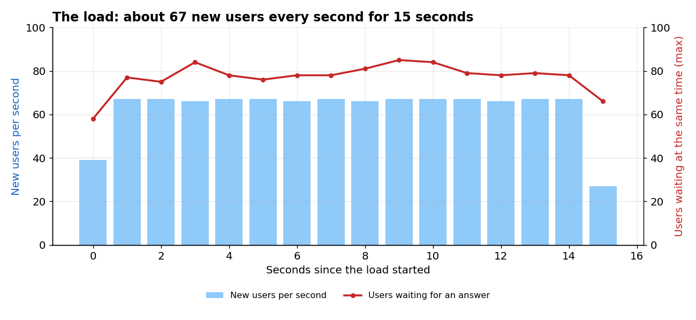

### How to run it

Requirements: Java and Apache JMeter 5.6.3.

1. Tell Windows where JMeter is (once), then open a new terminal:
   ```
   setx JMETER_HOME "C:\path\to\apache-jmeter-5.6.3"
   ```
2. From this folder, try a small run first (10 users over 5 seconds) to check everything works:
   ```
   run-load-test.bat -Jusers=10 -Jrampup=5
   ```
3. Run the real test (1000 users over 15 seconds):
   ```
   run-load-test.bat
   ```
4. Open `results\report\index.html` in a browser.

`run-load-test.bat` runs:

```
jmeter -n -t homepage-load-test.jmx -l results\results.csv -e -o results\report -f
```

| Option | Meaning |
| --- | --- |
| `-n` | Non-GUI mode |
| `-t` | The test plan |
| `-l` | Save every request to a results file |
| `-e -o` | Build the HTML report into a folder |
| `-f` | Replace the results of the previous run |
| `-Jusers`, `-Jrampup` | Optional: change the number of users and the ramp-up time without editing the plan |

**Trial run, 10 users** (results in [`results-trial-10-users/`](results-trial-10-users/)):

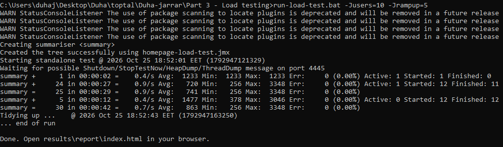

**Full run, 1000 users:**

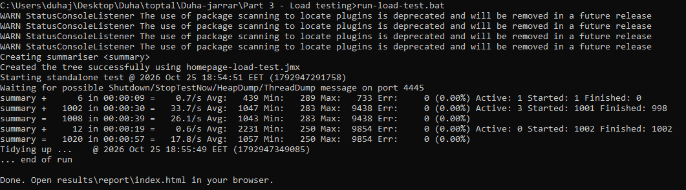

## 3. Results

All times are in milliseconds (ms). 1000 ms = 1 second. The charts are made from [`results/results.csv`](results/results.csv); the numbers in the tables come from JMeter's report.

**Every request of the test, in order.** Each dot is one request; the black line is the median of each second during the load:

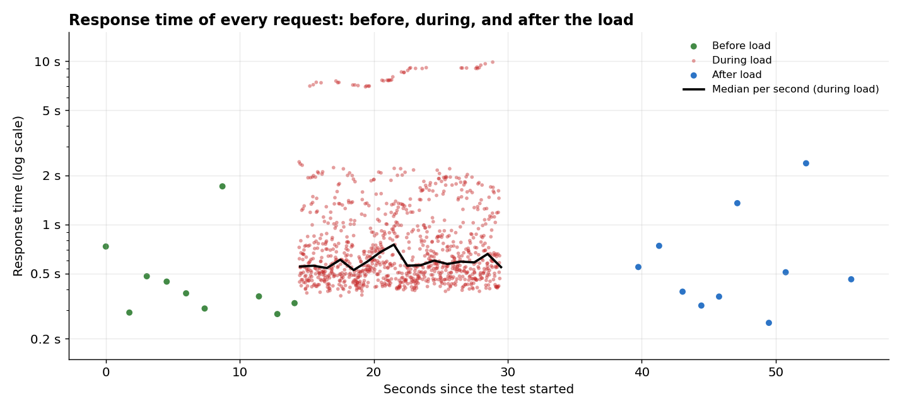

| Phase | Requests | Errors | Median | Average | 90th percentile | 95th percentile | 99th percentile | Slowest |
| --- | --- | --- | --- | --- | --- | --- | --- | --- |
| **Before load** | 10 | 0 (0%) | **371** | 532 | 1613 | 1711 | – | 1711 |
| **During load** | 1000 | 0 (0%) | **593** | **1066** | 1750 | 2156 | **9066** | **9854** |
| **After load** | 10 | 0 (0%) | **486** | 730 | 2266 | 2368 | – | 2368 |

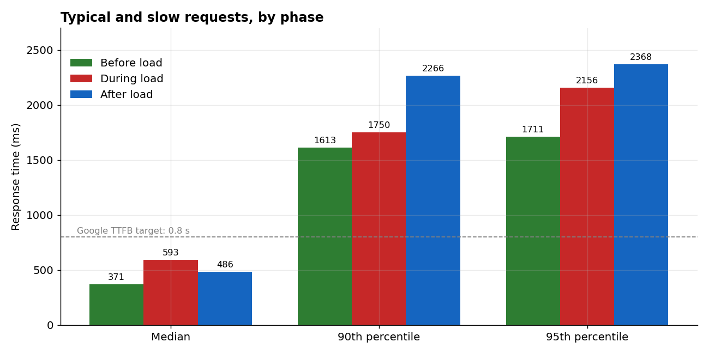

**How to read the percentiles:** "95th percentile = 2156 ms" means 95% of requests finished in 2156 ms or less, and 5% took longer. The **median** is the "typical" request, and it isn't pulled up by a few very slow ones the way the **average** is. With only 10 requests in the before and after phases, their percentiles are decided by the one or two slowest requests, so they jump around (the "after" 90th percentile is higher than "during" for this reason). The **median** is the fair comparison between phases.

**How long the 1000 requests took during the load:**

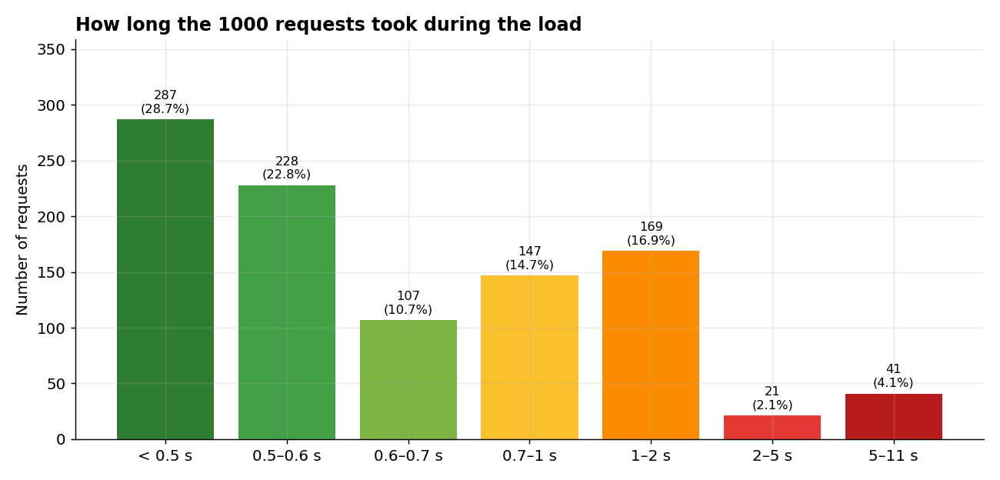

| Response time | Requests | Share |
| --- | --- | --- |
| Under 1 second | 769 | **76.9%** |
| 1–2 seconds | 169 | 16.9% |
| 2–5 seconds | 21 | 2.1% |
| **5–11 seconds** | **41** | **4.1%** |

**Over the 15 seconds of load**, split into 3-second slices:

| Seconds | Requests started | Median | Slowest |
| --- | --- | --- | --- |
| 0–3 | 201 | 579 | 7549 |
| 3–6 | 200 | 578 | 7140 |
| 6–9 | 200 | 574 | 9098 |
| 9–12 | 200 | 601 | 9112 |
| 12–15 | 199 | 616 | 9854 |

**Connection time (setting up the HTTPS connection):**

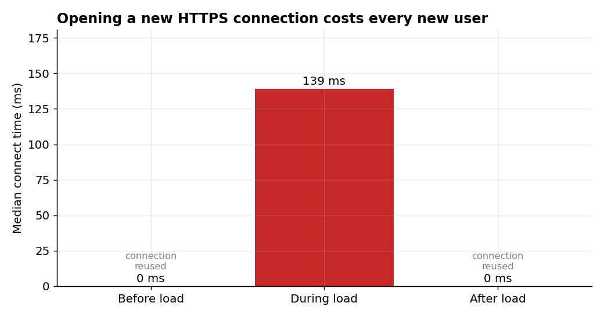

| Phase | Median connect time | Why |
| --- | --- | --- |
| Before load | 0 ms (414 ms for the first request only) | One user reuses the same connection (keep-alive) |
| During load | **139 ms** | Each of the 1000 users opens a new connection |
| After load | 0 ms | One user, connection reused |

## 4. Did the load affect the response time?

**Yes, in three ways:**

1. **Typical requests got somewhat slower.** The median went from **371 ms to 593 ms (+60%)**. A typical visitor would still see the page in well under a second.
2. **A separate group of requests got much slower.** This is the biggest effect. **41 requests (4.1%) took 7 to 10 seconds**, and the **99th percentile was 9066 ms**. The timeline chart shows they aren't the end of a smooth slowdown: they form their **own band**, with almost nothing between 2.5 and 7 seconds, and they appear across the whole load, not only at the peak.

   **Where did those seconds go?** Their connection setup was normal (median **140 ms**, the same as the fast requests). The wait happened **after** the request reached the server, before the first byte of the answer came back (median **7.5 seconds**, compared with 0.4 seconds for the other requests). So the delay was on the **server side**.

   One possible explanation: the site runs on Google Cloud (`server: Google Frontend`), which adds server instances automatically when traffic jumps. Requests sent to a new instance wait while it starts up (a "cold start"). **I tested this idea with two repeat runs, and it was not confirmed:** the slow band disappeared when the site was already busy, but it didn't come back after the site had been idle. See [Repeating 1000 users](scalability-report.md#3-repeating-1000-users-testing-the-cold-start-idea). The cause stays open; the site's monitoring would answer it.

   The **average doubled** (532 → 1066 ms) because of these slow requests.
3. **Every new user paid a connection cost.** Opening a new HTTPS connection added a median of **139 ms** per user during the load. Real new visitors pay this too.

**What did not change:**

- **No errors:** all 1000 requests during the load returned `200 OK`, so the site stayed available.
- **It recovered:** after the load, the median was 486 ms, close to the 371 ms before it.

**Throughput:** the site answered **41 requests per second** on average over the whole load phase. That's lower than the **67 new users per second** the test sent, because the slow requests stretched the phase beyond 15 seconds.

## 5. What is a good response time for a modern web application?

| Source | Guideline |
| --- | --- |
| **Human perception** (Jakob Nielsen's response time limits) | Under **0.1 s** feels instant. Under **1 s** keeps the user's flow of thought. Over **10 s**, users lose attention and often leave |
| **Google's web performance guidance** (web.dev) | **Time to First Byte (TTFB)** should be **0.8 s or less**. The main content should appear (**Largest Contentful Paint**) within **2.5 s**. Pages should respond to clicks and typing (**Interaction to Next Paint**) within **0.2 s** |
| **Common practice for server responses** | The HTML of a page in **about 200–500 ms**, and APIs in **under about 200–300 ms** |

These are measured at the **75th percentile** of real visits in Google's guidance, not just the average, because the slow visits matter.

**How BlazeDemo compares:**

| Measure | Result | Verdict |
| --- | --- | --- |
| Median response, before load | 371 ms | ✅ Good |
| Median response, during load | 593 ms | ✅ Within the 0.8 s TTFB target |
| 95th percentile, during load | 2156 ms | ⚠️ Slow for 1 in 20 visitors |
| 99th percentile, during load | 9066 ms | ❌ Close to the 10-second limit where users leave |

**Note:** these times were measured from Palestine, so they include the network distance to the server. A good part of every request is spent on the network, not on the server (see the next section).

## 6. Analysis of HTTP/S responses

### 6.1 Where the time goes in one request

Measured with curl, which reports the time of each step of a single request to the homepage:

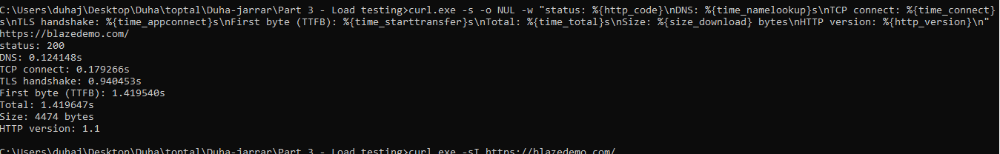

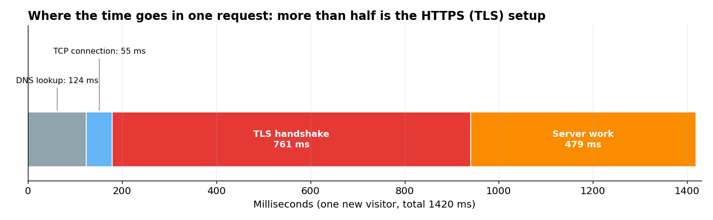

| Step | Time spent | Share | What happens |
| --- | --- | --- | --- |
| DNS lookup | 124 ms | 9% | Finding the server's IP address for `blazedemo.com` |
| TCP connection | 55 ms | 4% | Opening the network connection |
| **TLS handshake** | **761 ms** | **54%** | Setting up the encrypted HTTPS connection |
| **Server work** | **479 ms** | **34%** | From sending the request to the first byte of the answer |
| Download | under 1 ms | 0% | The page is only 4474 bytes |
| **Total** | **1420 ms** | | |

**More than half of a new visitor's wait is spent setting up HTTPS, before the server even starts working.** This is why reusing connections matters, and why it shows clearly in the test: one user reusing a connection had a median of 371 ms, while new connections took longer. JMeter showed the same pattern for a single request: connect time 1052 ms out of a total of 1528 ms.

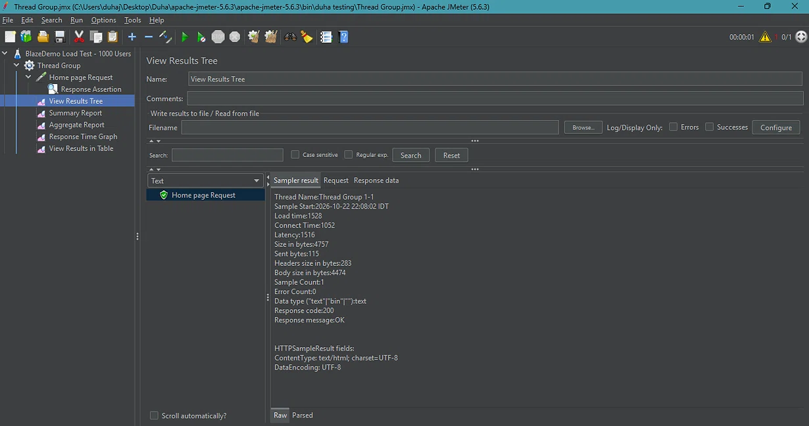

### 6.2 Homepage response

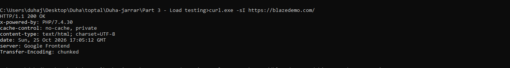

```http
HTTP/1.1 200 OK
x-powered-by: PHP/7.4.30
cache-control: no-cache, private
content-type: text/html; charset=UTF-8
date: Sun, 25 Oct 2026 17:05:12 GMT
server: Google Frontend
Transfer-Encoding: chunked
```

| Header | What it tells us |
| --- | --- |
| `HTTP/1.1 200 OK` | Success. The connection used HTTP/1.1, which sends one request at a time per connection; HTTP/2 would let a browser load many files over one connection |
| `server: Google Frontend` | The site is hosted on Google Cloud, behind Google's front-end servers |
| `x-powered-by: PHP/7.4.30` | The site runs on PHP 7.4.30. ⚠️ PHP 7.4 reached end of life in November 2022 and no longer gets security updates. Also, showing the exact version helps attackers look for known weaknesses. This header should be removed |
| `cache-control: no-cache, private` | Browsers and shared caches must check with the server every time and can't reuse a saved copy. **Every visit reaches the server**, which explains why the load has a direct effect on response time. For a homepage that rarely changes, short caching would reduce the load |
| `content-type: text/html; charset=UTF-8` | An HTML page encoded in UTF-8 |
| `Transfer-Encoding: chunked` | The page is sent in pieces, without announcing its full size first (no `Content-Length`) |

**Security headers missing** from the response: `Strict-Transport-Security` (forces browsers to always use HTTPS), `X-Content-Type-Options`, `Content-Security-Policy`, and `X-Frame-Options` (protection against loading the site inside another site's frame). These aren't about performance, but they're worth reporting.

### 6.3 Response for a page that doesn't exist

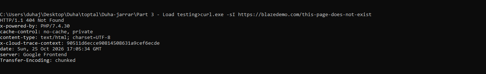

```http
HTTP/1.1 404 Not Found
x-powered-by: PHP/7.4.30
cache-control: no-cache, private
content-type: text/html; charset=UTF-8
x-cloud-trace-context: 90511d6ecce90814508631a9cef6ecde
date: Sun, 25 Oct 2026 17:05:34 GMT
server: Google Frontend
Transfer-Encoding: chunked
```

| Observation | Meaning |
| --- | --- |
| `404 Not Found` | ✅ Correct: a missing page returns 404, not `200` with an error message, so browsers and search engines understand it |
| `x-cloud-trace-context` | A Google Cloud request ID, used by the site's team to trace this request in their logs |
| Same `x-powered-by` and `cache-control` | The same server setup handles every page |

### 6.4 Response size

Every homepage response was **4757 bytes** (283 bytes of headers + 4474 bytes of HTML), in all 1020 requests, so the page content didn't change under load. During the load, JMeter received about **191 KB per second** from the site.

## 7. Limitations and next steps

- **One client machine, one location.** The load came from one laptop in Palestine, so network distance is part of every measurement. Running the same test from a server close to the site (or from several locations) would separate network time from server time more clearly.
- **HTML only.** A real browser also downloads images, CSS, and JavaScript, so real visitors would put more load on the site than this test did.
- **Small samples before and after.** The before and after phases have 10 requests each, enough to show the trend but not precise percentiles. A longer baseline would make the comparison stronger.
- **Server-side view.** The 7–10 second band points to a server-side wait. The [repeat runs](scalability-report.md#3-repeating-1000-users-testing-the-cold-start-idea) didn't confirm cold starts as the cause; the site's logs or monitoring would show the real cause.
- **Results vary between runs.** The same 1000-user test gave a 99th percentile of 9066, 885, and 2679 ms on three runs, so conclusions about the slowest requests need several runs.
- **One short burst.** The [step test](scalability-report.md#2-step-test-10-to-1000-users) showed where the slowdown begins. Next steps would be a longer test at a steady load (to find slowdowns that build up over time) and a stress test that increases users until errors appear (to find the site's limit).