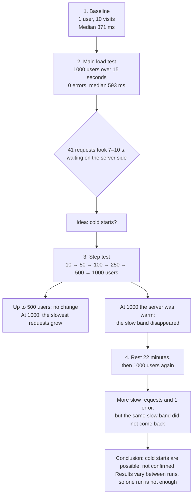
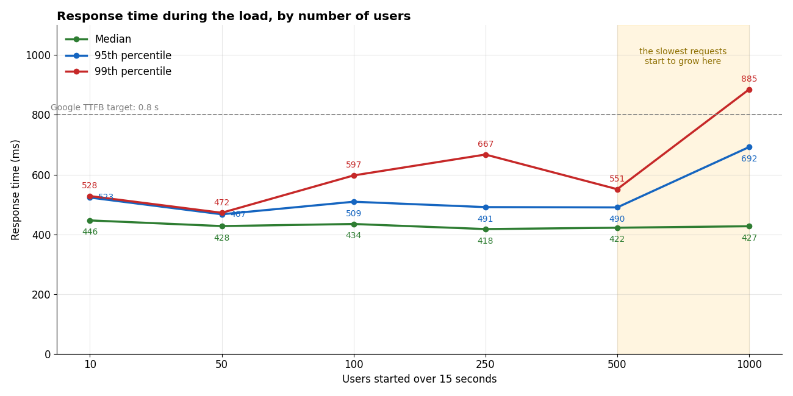
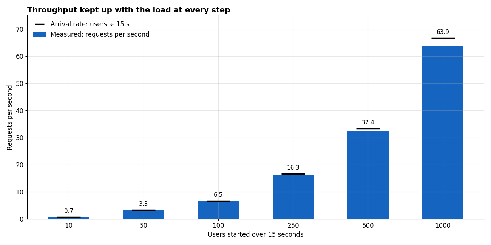
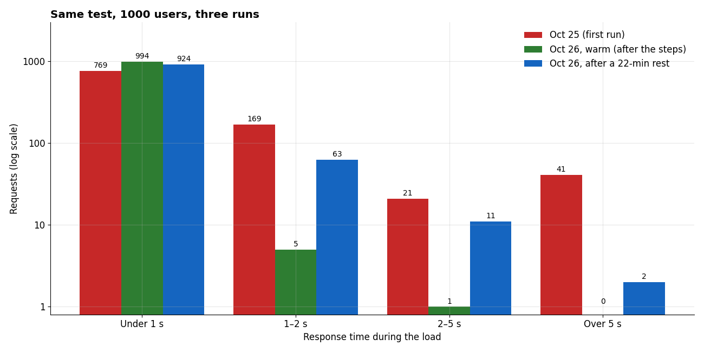

# Part 3 – Follow-up: Scalability Test and Repeat Runs

The [main load test](README.md) answered the task: 1000 users within 15 seconds, before, during, and after. It also left two open questions, so I ran two follow-up tests with the **same test plan**:

1. **At what load does the site start to slow down?** A step test from 10 to 1000 users.
2. **Were the 41 slow requests in the main test caused by "cold starts"?** The same 1000-user test, repeated after the site had been idle.

| | |
| --- | --- |
| **Website** | BlazeDemo – https://blazedemo.com |
| **Test plan** | [`homepage-load-test.jmx`](homepage-load-test.jmx), unchanged; only `-Jusers` changes between runs |
| **Run date** | October 26, 2026, 19:43–20:20 (EET) |
| **Raw results** | [`scaling/`](scaling/): one CSV file per run, and JMeter's HTML report for each step (for example [`scaling/report-500/index.html`](scaling/report-500/index.html)) |

All times are in milliseconds (ms). The numbers in this report are calculated from the CSV files.

## The order of the tests

Each test answered a question raised by the one before it:



| Step | When | Test | Why | What I found |
| --- | --- | --- | --- | --- |
| **1. Baseline** | Oct 25, 18:54 | 1 user, 10 visits, 1 second apart | Normal response time with no load | Median **371 ms** |
| **2. Main load test** | Oct 25, 18:54 | **1000 users over 15 seconds**, 1 visit each | The task | 0 errors, median **593 ms**, but **41 requests took 7–10 seconds**, waiting on the **server side**. Idea: cold starts |
| **3. Step test** | Oct 26, 19:43–19:57 | 10 → 50 → 100 → 250 → 500 → 1000 users, 2-minute pause between steps | Where does the slowdown begin? | Flat up to 500 users. At 1000, the slowest requests start to grow. The server was already busy (**warm**), and **the 41-request slow band disappeared** (0 requests over 5 s) |
| **4. Repeat after a rest** | Oct 26, 20:19 | 1000 users again, after **22 minutes** with no requests | If cold starts caused the slow band, it should come back on a rested server | More slow requests than the warm run (76 over 1 s) and **1 error**, but **the same server-side slow band did not come back** (2 requests over 5 s, both slow while connecting) |
| **Conclusion** | | | | Cold starts are **possible but not confirmed**. Proving it needs server-side data (instance count, logs). The slowest requests vary a lot between runs, so one run isn't enough |

Separately, a curl measurement of one request showed where a new visitor's time goes: DNS 124 ms, TCP 55 ms, **TLS handshake 761 ms (54%)**, server 479 ms. This is a single-request breakdown; it is not what caused the 41 slow requests, whose delay was on the server side.

## Summary

| Question | Answer |
| --- | --- |
| Did any step fail? | **No.** 0 errors from 10 up to 1000 users |
| Did the typical request slow down as the load grew? | **No.** The median stayed at about **420–450 ms** at every step |
| Did the site keep up with the load? | **Yes.** Requests per second grew in line with the users at every step, so the site never reached its limit |
| Where does the slowdown begin? | **Between 500 and 1000 users.** Up to 500, everything is flat. At 1000, the slowest requests start to grow (95th percentile 490 → 692 ms) |
| Was the slow band in the main test caused by cold starts? | **Not confirmed.** The same 41-request band didn't come back in either repeat run |
| Are the results stable between runs? | **No.** The same 1000-user test gave very different slow requests on three runs, so one run isn't enough to draw conclusions |

## 1. How the tests were run

**Step test.** Six runs, one after another, each with the same 15-second ramp-up, so the arrival rate grows with the number of users (from about 1 user every 1.5 seconds at 10 users, to about 67 users per second at 1000). Each run also includes the "before" and "after" phases of the test plan. A **2-minute pause** between runs lets the site settle:

```bat
mkdir scaling
for %u in (10 50 100 250 500 1000) do (call "%JMETER_HOME%\bin\jmeter.bat" -n -t homepage-load-test.jmx -Jusers=%u -Jrampup=15 -l scaling\users-%u.csv -e -o scaling\report-%u -f & timeout /t 120)
```

The results go into a separate `scaling` folder, so the main test's results in `results/` stay unchanged.

**Repeat run after a rest.** About **22 minutes** after the step test ended, with no requests from me in between, the 1000-user test was run once more:

```bat
call "%JMETER_HOME%\bin\jmeter.bat" -n -t homepage-load-test.jmx -Jusers=1000 -Jrampup=15 -l scaling\cold-1000.csv -e -o scaling\report-cold-1000 -f
```

## 2. Step test: 10 to 1000 users

**During the load:**

| Users | New users per second | Requests per second | Peak users waiting at once | Median | 90th pct | 95th pct | 99th pct | Slowest | Errors |
| --- | --- | --- | --- | --- | --- | --- | --- | --- | --- |
| 10 | 0.7 | 0.7 | 1 | 447 | 516 | 523 | 528 | 529 | 0 |
| 50 | 3.3 | 3.3 | 2 | 428 | 455 | 467 | 472 | 475 | 0 |
| 100 | 6.7 | 6.5 | 4 | 435 | 478 | 509 | 597 | 622 | 0 |
| 250 | 16.7 | 16.3 | 10 | 418 | 461 | 491 | 667 | 775 | 0 |
| 500 | 33.3 | 32.4 | 18 | 422 | 464 | 490 | 551 | 716 | 0 |
| **1000** | **66.7** | **63.9** | **72** | **427** | **579** | **692** | **885** | **4868** | **0** |

With only 10 or 50 requests, the 95th and 99th percentiles are decided by the one or two slowest requests, so they're less precise at the small steps.





**Before and after each step** (1 user, 10 visits), the median stayed between **267 and 364 ms**, so the site went back to normal after every step.

### What the step test shows

1. **The typical request didn't slow down at all.** The median stayed at about 430 ms from 10 to 1000 users.
2. **The site kept up with the load.** At every step, the requests per second matched the rate at which users arrived. If the site had reached its limit, requests would queue up, and this number would stop growing while response times climbed.
3. **The slowdown starts between 500 and 1000 users.** Up to 500 users (about 33 requests per second), all percentiles are flat. At 1000 users (about 64 requests per second), the median is still the same, but the slowest requests start to grow: the 90th percentile went from 464 to 579 ms, the 95th from 490 to 692 ms, and the 99th from 551 to 885 ms. This is the start of a slowdown, not a limit: there were no errors, and 99.4% of requests finished in under 1 second.
4. **Users overlapped very little.** Each request finished in about half a second, so even at 1000 users, at most 72 were waiting for an answer at the same time.

## 3. Repeating 1000 users: testing the cold-start idea

### The idea

In the main test, **41 requests (4.1%) took 7 to 10 seconds**. Their connection setup was normal, and the wait was on the server side. The site runs on Google Cloud, which starts new server instances when traffic jumps, so one possible explanation was **cold starts**: requests waiting while new instances start up.

If that's the cause, then:

- When the site is **already busy** (right after the step test), the slow band should **disappear**.
- When the site has been **idle**, the slow band should **come back**.

### The results

| | Oct 25 (main test) | Oct 26, warm (right after the 500-user step) | Oct 26, after a 22-minute rest |
| --- | --- | --- | --- |
| Median | 593 | 427 | 444 |
| 95th percentile | 2156 | 692 | 1192 |
| 99th percentile | 9066 | 885 | 2679 |
| Slowest | 9854 | 4868 | 10975 |
| Requests over 1 second | 231 | 6 | 76 |
| Requests over 5 seconds | **41** | **0** | **2** |
| Errors | 0 | 0 | **1** |
| Requests per second | 41 | 63.9 | 58.8 |

The Oct 25 percentiles come from JMeter's HTML report; the Oct 26 ones are calculated from the CSV files. Both use the same 1000 requests per run.



### What the repeat runs show

1. **Warm run: the slow band was gone.** No request took more than 5 seconds. This matches the cold-start idea, but it could also be different network conditions or a different load on the site.
2. **Rested run: the slow band did not come back.** Only **2 requests** took over 5 seconds, and for both of them, the time was spent **opening the connection** (4.5 and 11 seconds of connect time), not waiting on the server. That's a different pattern from the 41 server-side waits in the main test.
3. **Rested run: the slower requests did increase.** 76 requests took over 1 second, compared with 6 in the warm run. Most of them started between **6 and 10 seconds** into the ramp-up, and their extra time was split between connecting and waiting on the server.
4. **Rested run: the first error.** One request failed after 11 seconds with `NoHttpResponseException: blazedemo.com:443 failed to respond`: the connection was opened, but the server never answered. That's **0.1%** of the requests.

### Verdict

**Cold starts are possible but not confirmed.** The warm run fits the idea, but the rested run didn't reproduce the main test's pattern. Testing from the outside, I can't see how many server instances were running, so I can't separate cold starts from other causes, like the network or other traffic on this public demo site. The site's monitoring (instance count and request logs at the time of the test) would answer this.

What these runs **do** show is that **the same test can give very different slow requests on different runs**, while the median stays steady. A conclusion about the slowest requests needs several runs, not one.

## 4. Conclusions

- **BlazeDemo's homepage handles 1000 users over 15 seconds without errors in 2 of 3 runs, and with 1 error in 1000 requests in the third.** The typical response stays at about 430–600 ms at every load tested.
- **Up to 500 users in 15 seconds, the load has no measurable effect.** Between 500 and 1000 users, the slowest requests start to grow, while the typical request doesn't change.
- **The site never reached its limit** in these tests: requests per second kept up with the arrival rate at every step.
- **The slowest requests vary a lot between runs.** The 99th percentile for the same 1000-user test was 9066, 885, and 2679 ms on three runs.

## 5. Next steps

- **Narrow down the slowdown point** with steps between 500 and 1000 users (for example 600, 750, and 900).
- **Find the limit** with a stress test that keeps adding users until errors appear or requests per second stop growing.
- **Repeat each run several times**, at different times of day, and compare the spread, not a single result.
- **Get the server-side view** (instance count, CPU, and request logs) to confirm or rule out cold starts.
- **Run from a machine close to the server**, so network time doesn't hide the server's own behavior.